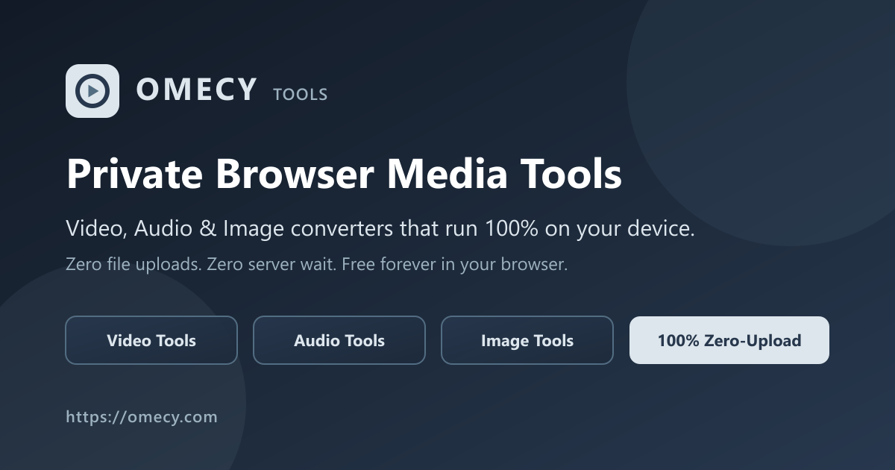
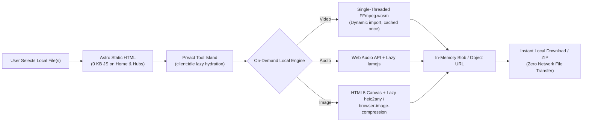

<div align="center">

<a href="https://omecy.com/">
  
</a>

# OMECY Tools

**Ultra-fast, 100% private, zero-upload online Video, Audio, and Image utilities that run entirely inside your browser.**

[](https://omecy.com/)
[](./LICENSE)
[](https://astro.build)
[](https://tailwindcss.com)
[-27374D?style=for-the-badge)](https://omecy.com/)
[](https://omecy.com/privacy)

[Live App](https://omecy.com/) · [Privacy Architecture](https://omecy.com/privacy) · [Report Bug](https://github.com/Kishara007/omecy-tools/issues) · [Support the Developer](https://kisharadilshan.gumroad.com/coffee)

</div>

---

## Table of Contents

- [Why OMECY Tools?](#why-omecy-tools)
- [UX & Craftsmanship Highlights](#ux--craftsmanship-highlights)
- [12 Focused Browser Media Tools](#12-focused-browser-media-tools)
- [Zero-Upload Architecture](#zero-upload-architecture)
- [Tech Stack](#tech-stack)
- [Project Structure](#project-structure)
- [8-Language Internationalization (136 Static Pages)](#8-language-internationalization-136-static-pages)
- [Technical SEO & Performance](#technical-seo--performance)
- [Local Development & Scripts](#local-development--scripts)
- [Deploying to Cloudflare Pages](#deploying-to-cloudflare-pages)
- [Contributing](#contributing)
- [Support & License](#support--license)

---

## Why OMECY Tools?

Most online converters require uploading personal photos, private voice memos, or confidential screen recordings to remote servers—introducing upload bottlenecks, queues, watermarks, file-size caps, and privacy risks.

**OMECY Tools** runs every decode, trim, resize, merge, and compression job **100% locally inside the active browser tab**.

| Aspect | Traditional Cloud Converters | OMECY Tools |
| :--- | :--- | :--- |
| **File Privacy** | Uploaded to third-party servers | **Files never leave your device** |
| **Processing Speed** | Upload wait + server queue + download | **Instant local CPU / WebAssembly execution** |
| **Backend & Storage Cost** | Expensive media servers & buckets | **Zero backend — 100% static edge hosting** |
| **Watermarks & Accounts** | Often gated behind sign-ups or paywalls | **Free, MIT open-source, no accounts** |
| **Third-Party Script / AdSense Safety** | N/A | **No COOP/COEP headers required** (single-threaded core) |

---

## UX & Craftsmanship Highlights

- **Instant Auto-Convert + Collapsible `More Settings`:** Across 9 conversion and compression utilities, dropping a file triggers immediate local processing with smart defaults. Power users can expand **More Settings**, adjust options, and click **Apply**—smoothly scrolling straight to the refreshed output marked with a live `✓ Updated` badge.
- **DAW/NLE Timeline & Playhead Editor:** Both **MP3 Cutter** (interactive audio waveform) and **Video Trimmer** (extracted video filmstrip) include graduated time rulers, a draggable crimson playhead, click-to-seek, dedicated **Play/Pause** and **Preview Selection** controls, animated snap-to-playhead cut buttons (`[`, `]`), `1×–6×` zoom, and frame-accurate trimming.
- **Interactive Before / After Image Comparator:** **Image Compressor** features a tactile GPU `clip-path` comparison slider (mouse, touch, and keyboard accessible) with a transparency checkerboard backdrop, live format conversion (`Original`, `JPG`, `PNG`, `WebP`), quality control, and multi-file ZIP export.
- **Aspect-Aware Visual Framing in Image Resizer:** Whenever the chosen preset or custom dimensions change the aspect ratio, an interactive visual framing editor opens automatically with **Crop** (aspect-locked drag + L-bracket corner zoom + rule-of-thirds grid), **Fit Whole** (Blur / White / Black / Transparent / Custom Color backdrop), and **Stretch** modes.
- **Signature Orbital Dropzone & Engine Loader:** Every upload dropzone features a pure CSS/SVG animated orbital emblem that smoothly transitions into the local browser-engine loader during first-run WebAssembly downloads—respecting `prefers-reduced-motion`.
- **Adaptive Light & Dark Mode:** Anti-FOUC inline `<head>` theme initialization, WCAG 2.1 AA contrast tokens, and a responsive 5-icon mobile/tablet navigation bar with an expandable utility drawer.

---

## 12 Focused Browser Media Tools

Every tool ships on a clean flat canonical slug alongside 3 Category Hubs (`/video-tools`, `/audio-tools`, `/image-tools`) and a transparent Privacy Policy (`/privacy`).

| Category | Tool | Route | Local Engine | Key Capabilities |
| :--- | :--- | :--- | :--- | :--- |
| **Video** | **Video to MP3 Converter** | `/video-to-mp3` | Lazy FFmpeg.wasm | Instant MP3 extraction (128–320 kbps) from MP4, MOV, WebM, MKV |
| **Video** | **WebM to MP4 Converter** | `/webm-to-mp4` | Lazy FFmpeg.wasm | Screen-recorded & browser WebM to universal H.264 + AAC MP4 |
| **Video** | **Video Compressor** | `/video-compressor` | Lazy FFmpeg.wasm | WhatsApp, Discord, Email, Web presets + custom CRF & resolution scaling |
| **Video** | **Online Video Trimmer** | `/video-trimmer` | Lazy FFmpeg.wasm | Filmstrip timeline, playhead scrubbing, snap cuts, frame-accurate or lossless copy |
| **Audio** | **Audio Joiner & MP3 Merger** | `/audio-joiner` | Web Audio + `lamejs` | Multi-track MP3/WAV/M4A merge, drag-to-reorder, equal-power crossfade |
| **Audio** | **MP3 Cutter & Audio Trimmer** | `/mp3-cutter` | Web Audio + `lamejs` | Zoomable waveform, playhead & selection preview, smooth fade-in / fade-out |
| **Audio** | **WAV to MP3 Converter** | `/wav-to-mp3` | Web Audio + `lamejs` | Instant bulk WAV-to-MP3 (128–320 kbps), audio preview, ZIP download |
| **Audio** | **M4A to MP3 Converter** | `/m4a-to-mp3` | Web Audio + `lamejs` | Instant bulk iPhone Voice Memos & Apple M4A to MP3 + ZIP export |
| **Image** | **Image Compressor** | `/image-compressor` | Canvas + Compression | Before/After slider, `Original`/`JPG`/`PNG`/`WebP` output, quality control, bulk ZIP |
| **Image** | **WebP to JPG Converter** | `/webp-to-jpg` | HTML5 Canvas | Instant bulk WebP-to-JPG with custom transparency fill color + ZIP export |
| **Image** | **HEIC to JPG Converter** | `/heic-to-jpg` | Lazy `heic2any` | Private local iPhone/iOS HEIC decoding to JPG with quality control & ZIP |
| **Image** | **Image Resizer** | `/image-resizer` | HTML5 Canvas | Pixels/`%`, social presets, visual **Crop / Fit Whole / Stretch**, JPG/PNG/WebP |

---

## Zero-Upload Architecture



### Core Engineering Invariants

1. **Zero Eager FFmpeg Bundling:** `@ffmpeg/ffmpeg` is dynamically imported exclusively inside user-triggered jobs and verified via `npm run audit:seo` (`Initial Bundles Loading FFmpeg: 0`).
2. **Single-Threaded WASM Only:** Uses `@ffmpeg/core` (never `@ffmpeg/core-mt`), avoiding `SharedArrayBuffer` and `COOP`/`COEP` headers so third-party embeds and Google AdSense work seamlessly.
3. **Automatic Memory Hygiene:** Every `URL.createObjectURL()` preview and output blob is revoked via independent lifecycle hooks on replacement, removal, clear, and unmount.

---

## Tech Stack

| Layer | Technology |
| :--- | :--- |
| **Meta-Framework** | [Astro v7](https://astro.build) (`output: 'static'`, `build.format: 'file'`, `trailingSlash: 'never'`) |
| **Interactive Islands** | [Preact](https://preactjs.com) (`client:idle` on tool pages; `0 KB` island JS on Home & Category Hubs) |
| **Styling** | [Tailwind CSS v4](https://tailwindcss.com) (`@tailwindcss/vite`, custom Light/Dark design tokens) |
| **Type Safety** | Strict TypeScript + `astro check` |
| **Client Media Engines** | `@ffmpeg/ffmpeg`, Web Audio API, `@breezystack/lamejs`, HTML5 Canvas API, `browser-image-compression`, `heic2any`, `jszip` |
| **SEO & Sitemaps** | `@astrojs/sitemap`, automated post-build audit (`scripts/audit-seo.mjs`), `sharp` OG/favicon generator |
| **Edge Hosting** | [Cloudflare Pages](https://pages.cloudflare.com) (`wrangler.toml`, `public/_headers`, `public/robots.txt`) |

---

## Project Structure

```text
omecy-tools/
├── public/
│   ├── _headers                  # Cloudflare cache, security & sitemap XML headers (no COOP/COEP)
│   ├── robots.txt                # Crawler directives + Sitemap index pointer
│   ├── site.webmanifest          # PWA / web application manifest
│   ├── favicon.svg               # Scalable vector emblem
│   ├── favicon-32x32.png         # Standard PNG favicon
│   ├── apple-touch-icon.png      # 180×180 touch icon & Organization schema logo
│   └── og-image.png              # 1200×630 Open Graph / Twitter share card
├── scripts/
│   ├── audit-seo.mjs             # Automated 8-point SEO, schema, sitemap, a11y & bundle audit
│   └── generate-assets.mjs       # Reproducible Sharp generator for OG image & PNG icons
├── src/
│   ├── config/site.ts            # Site metadata, 8 locales, category hubs & 12-tool registry
│   ├── i18n/
│   │   ├── ui/{en..ru}.ts        # Localized navigation, homepage, hubs, privacy & tool UI strings
│   │   └── tools/{en..ru}.ts     # Unique localized metadata, guides, FAQs & copy for all 12 tools
│   ├── layouts/BaseLayout.astro  # Document shell, skip link, GTM/GA4, Navbar & Footer
│   ├── lib/
│   │   ├── ffmpeg.ts             # Lazy single-threaded FFmpeg.wasm loader & runner
│   │   ├── audio-engine.ts       # Web Audio decode/trim/merge + lazy lamejs MP3 encoder
│   │   ├── image-engine.ts       # Canvas compress/convert/crop/contain/stretch + lazy heic2any
│   │   └── format.ts             # Formatting, ZIP packaging & smart smooth-scroll helper
│   ├── components/
│   │   ├── seo/                  # HeadSEO.astro (meta/OG/hreflang/JSON-LD), Breadcrumbs.astro
│   │   ├── layout/               # Navbar.astro, Footer.astro
│   │   ├── pages/                # HomePage, CategoryPage, ToolPage, PrivacyPage templates
│   │   └── tools/                # 12 Preact tool islands + common/ UI primitives
│   └── pages/                    # index.astro, [slug].astro, [lang]/[slug].astro (136 static pages)
├── astro.config.mjs              # Static i18n, sitemap serializer & dev sitemap preview middleware
├── wrangler.toml                 # Cloudflare Pages project config
└── package.json
```

---

## 8-Language Internationalization (136 Static Pages)

OMECY pre-renders **136 localized static HTML pages** (`17` routes × `8` languages) with `prefixDefaultLocale: false`:

| Language | Locale | Base URL |
| :--- | :---: | :--- |
| **English (Default)** | `en` | `https://omecy.com/` |
| **Español** | `es` | `https://omecy.com/es` |
| **Português** | `pt` | `https://omecy.com/pt` |
| **Deutsch** | `de` | `https://omecy.com/de` |
| **Français** | `fr` | `https://omecy.com/fr` |
| **日本語** | `ja` | `https://omecy.com/ja` |
| **简体中文** | `zh-cn` | `https://omecy.com/zh-cn` |
| **Русский** | `ru` | `https://omecy.com/ru` |

- Switching languages preserves the active route (e.g., `/image-compressor` ↔ `/ja/image-compressor`).
- Every page outputs a complete **9-link bidirectional `hreflang` cluster** (`8` languages + `x-default`), mirrored identically inside `sitemap-0.xml`.

---

## Technical SEO & Performance

Every build is gated by `npm run verify` (`astro check && astro build && node scripts/audit-seo.mjs`):

- **Unique Metadata Bounds:** All 136 pages maintain unique `<title>` (`50–59` chars) and `<meta name="description">` (`130–151` chars) tags, rich `robots` preview directives, complete Open Graph (`og:image:type`, `secure_url`, `1200×630`, `alt`), Twitter Cards, and `site.webmanifest`.
- **Clean Entity-Linked JSON-LD:**
  - **Homepages:** `@id`-linked `Organization` + `WebSite` + `WebPage` + 12-item `ItemList` (no homepage breadcrumbs).
  - **Category Hubs:** `CollectionPage` + `BreadcrumbList`.
  - **Tool Pages:** `WebApplication` + `FAQPage` (matching visible HTML 1:1) + `BreadcrumbList`.
  - **Zero Fake Ratings:** Strictly zero fabricated `AggregateRating` or `Review` schema anywhere.
- **GSC-Safe Sitemaps & Canonicals:** Flat `.html` build format with `trailingSlash: 'never'` produces HTTP `200` clean URLs on Cloudflare Pages with zero trailing-slash redirects, self-referencing canonicals, `<lastmod>` timestamps, and `x-default` alternates in `sitemap-0.xml`.
- **Zero-JS Static Landing Pages:** Homepages and Category Hubs ship `0 KB` of island JS; tool islands hydrate lazily via `client:idle`.

---

## Local Development & Scripts

### Prerequisites

- **Node.js** `20+` (recommended LTS)
- **npm** `10+`

### Quick Start

```bash
# 1. Clone the repository
git clone https://github.com/Kishara007/omecy-tools.git
cd omecy-tools

# 2. Install dependencies
npm install

# 3. Start the local dev server (http://localhost:4321)
npm run dev

# 4. Run full type-check, static build, and automated SEO audit
npm run verify
```

### Available Commands

| Script | Purpose |
| :--- | :--- |
| `npm run dev` | Start the Astro development server on `http://localhost:4321` (also serves built `/sitemap-index.xml` & `/sitemap-0.xml`) |
| `npm run build` | Run `astro check` (TypeScript diagnostics) and build all 136 static pages + sitemap into `./dist` |
| `npm run preview` | Serve the production `./dist` build locally |
| `npm run audit:seo` | Run `scripts/audit-seo.mjs` across all 136 pages, sitemaps, headers, and JS bundles |
| `npm run verify` | Run `npm run build` followed by `npm run audit:seo` (CI / pre-deploy gate) |
| `npm run generate:assets` | Regenerate `public/og-image.png` (`1200×630`), `favicon-32x32.png`, and `apple-touch-icon.png` |
| `npm run deploy` | Build and publish `./dist` directly to Cloudflare Pages via Wrangler |

---

## Deploying to Cloudflare Pages

### Option A — Git Integration (Recommended)

1. Push your repository to GitHub.
2. Open **Cloudflare Dashboard → Workers & Pages → Create → Pages → Connect to Git**.
3. Configure the build settings:
   - **Framework preset:** `Astro`
   - **Build command:** `npm run build`
   - **Build output directory:** `dist`
4. Connect your custom domain (`omecy.com`) and submit `https://omecy.com/sitemap-index.xml` in **Google Search Console**.

### Option B — Wrangler CLI

```bash
npm run deploy
```

[`wrangler.toml`](./wrangler.toml) is pre-configured with `name = "omecy-tools"` and `pages_build_output_dir = "./dist"`.

---

## Contributing

Contributions—bug fixes, UX refinements, translation improvements, and new 100% client-side tools—are welcome!

1. Fork the repository and create a branch (`git checkout -b feat/your-improvement`).
2. Keep every tool **100% client-side** (zero file uploads, lazy heavy engines, zero `COOP`/`COEP` headers).
3. Maintain **8-language parity** across `src/i18n/ui/*.ts` and `src/i18n/tools/*.ts` when adding UI strings or tools.
4. Run `npm run verify` before opening a Pull Request to confirm `0` TypeScript errors, `0` warnings, and `100%` SEO audit compliance.

---

## Support & License

If **OMECY Tools** saves you time or helps keep your media private, consider supporting ongoing open-source development:

<a href="https://kisharadilshan.gumroad.com/coffee">
  
</a>

Released under the **[MIT License](./LICENSE)** — Copyright © 2026 **Kishara Dilshan**.
